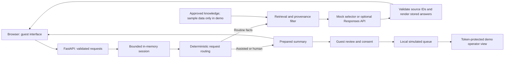

# Architecture and presentation notes

One process serves the API and static frontend on loopback. Only `frontend/` is publicly served, never `.env`, knowledge files, or Python code. CORS and Host allowlists, an 8 KiB body limit, field validation, safe errors, request IDs, and a restrictive content policy define the local API boundary. The staff queue requires a server-side bearer token and is disabled unless demo mode and a token are configured.

| Decision level | Examples | Permitted behavior |
|---|---|---|
| AI | Supported FAQ, approved policy explanation | Return sourced text; explain sample status |
| Assisted | Housekeeping, maintenance, first unknown question | Acknowledge concern; prepare summary; ask consent |
| Human | Manager, refund, serious distress, emergency, repeated unknowns, stay changes | Refer to a person; no automated fulfillment |

Urgent safety routing takes priority over every dialogue stage and provider. It tells the guest to contact local emergency services if in immediate danger, without asserting dispatch. Keyword detection is an English MVP heuristic, not a comprehensive safety classifier. Negation, slang, multilingual inputs, subtle risk, and complex compound questions require more review before any real-world use.

Sessions have opaque UUIDs, per-session concurrency locks, a default 12-message bounded context, and 30-minute inactivity expiration with periodic cleanup. Only controlled topic context and generated replies enter history; raw user messages are not retained server-side. Queue summaries contain controlled categories and topic context, not transcripts, and expire after the same configured duration. No server chat-text logs are written; aggregate counters and latency totals have no guest identifiers. Browser state stays in tab memory. A reset clears server session state where reachable; submitted queue summaries expire independently.

Capacity is bounded at 500 sessions/queue entries and 30 chat requests per session per minute. These are demo limits, not public anti-abuse controls. There is no multi-worker storage, identity system, property-management integration, real booking, refund, dispatch, or notification. Public deployment needs a separate design for authentication, abuse protection, durable storage/retention, secrets, HTTPS, approved contacts, monitoring, and risk review.

Presenter notes: explain the browser/API boundary, source provenance, source-selection model constraint, and independent human-routing policy. Psychologically, the local alligator avatar and concise acknowledgement aim for friendliness; the explicit AI/demo label and action limits aim for calibrated trust. These are design intentions, not measured guest perceptions. Management retains authority over guest identity, room assignment, money, and safety response. Show the three-level matrix with the dirty-room and manager scenarios.
